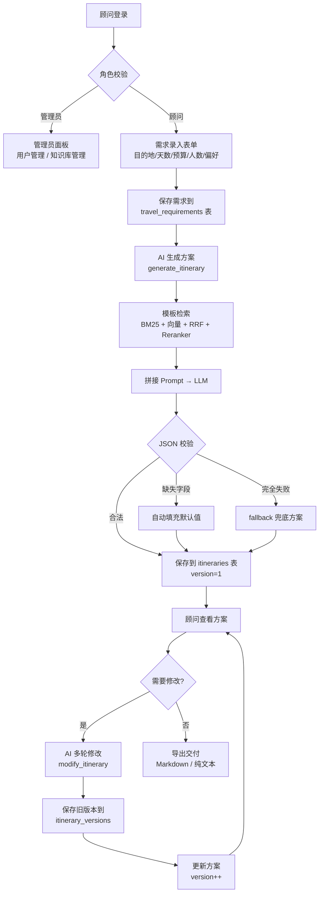

# 🏢 B端智能行程方案生成系统

> **LangChain + RAG + Streamlit** 构建的旅行社/研学机构智能行程方案生成系统  
> 支持标准化需求录入 → AI 结构化生成 → 多轮修改 → 版本管理 → 一键导出交付

[](https://www.python.org/)
[](https://www.langchain.com/)
[](https://streamlit.io/)
[](tests/)
[](https://github.com/aibiyaqi/travel-itinerary-ai/actions/workflows/ci.yml)
[](docs/DEPLOYMENT.md)

---

## 📸 功能概览

| 功能 | 说明 |
|------|------|
| 📋 **标准化需求录入** | 结构化表单：目的地/天数/预算/人数/偏好/特殊需求，前端实时校验 |
| 🤖 **AI 结构化生成** | 基于 LangChain + 通义千问，输出结构化 JSON 行程方案，含三层防御降级 |
| 🔄 **多轮 AI 修改** | 顾问输入修改意见，AI 在原方案基础上调整，版本自动存档 |
| 📚 **版本管理** | 每次修改自动递增版本号，保留全部历史版本（回溯接口已具备，UI 暂未开放） |
| 👥 **多角色权限** | 管理员（用户管理+知识库管理+操作日志）vs 顾问（业务操作） |
| 🔐 **登录持久化** | 服务端 Token 认证（SQLite auth_tokens 表，12 小时），页面刷新/浏览器重启不丢失登录状态 |
| 🧾 **操作审计** | 登录/生成/修改/状态变更/导出/建号/上传全量落表，管理员可筛选查看 |
| 🗄️ **业务数据库** | 8 张业务表：users / clients / requirements / itineraries / versions / auth_tokens / admin / audit_logs |
| 📤 **导出交付** | 一键导出 Markdown / 纯文本 / 客户版 HTML（可直接打印为 PDF） |
| 🔍 **模板知识库** | 启动时自动导入 4 套内置模板（29 条），BM25 + 向量融合；Cross-Encoder 精排可选 |

---

## 🏗️ 项目架构

```
B端智能行程方案生成系统/
├── src/
│   ├── app.py                  # Streamlit 多页面 B 端系统（登录/需求录入/方案列表/详情/管理面板）
│   ├── rag_chain.py            # ❤️ 核心：generate_itinerary() + modify_itinerary() + fallback 兜底
│   ├── db_service.py           # 8 张业务表 CRUD + 版本管理 + Token 认证（SQLite + bcrypt）
│   ├── export_service.py       # 导出交付：export_to_markdown() / export_to_text()
│   ├── retriever.py            # 混合检索：BM25 + 向量 + RRF + Reranker（模板知识库用）
│   ├── data_loader.py          # 数据解析：JSONL/CSV/PDF → 切分 → 向量化入库
│   ├── config.py               # B 端常量体系：行程类型/偏好/状态枚举/角色定义
│   └── __init__.py
├── tests/                      # 🧪 92 个自动化测试
│   ├── test_config.py          #   配置加载测试（4）
│   ├── test_data_loader.py     #   数据加载测试（9）
│   ├── test_rag_chain.py       #   AI 生成核心测试（34）
│   ├── test_retriever.py       #   混合检索融合测试（3）
│   ├── test_db_service.py      #   数据库业务测试（30）
│   └── test_export_service.py  #   导出功能测试（9）
├── data/
│   ├── business_templates/     # 📦 4 套内置模板（29 条），启动时自动入库
│   └── eval/                   # 🧪 检索评测集（25 条人工标注查询）
│       ├── scenic_spots.jsonl       # 景点知识
│       ├── destination_notes.jsonl  # 目的地注意事项
│       ├── itinerary_templates.jsonl # 行程模板
│       └── safety_templates.jsonl   # 安全提示
├── nginx/                      # Nginx 反向代理配置
│   └── nginx.conf
├── docker-compose.yml          # Docker Compose 生产部署
├── Dockerfile                  # 多阶段构建 + 健康检查 + 非 root 用户
├── .env.example                # 环境变量模板（复制为 .env）
├── requirements.txt            # 精确版本依赖清单
├── chroma_db/                  # 向量数据库持久化目录（gitignore）
├── biz_data.db                 # 业务数据库文件（gitignore）
└── plans/                      # 技术文档
    ├── 项目改造计划_B端行程方案系统.md  # B 端改造方案
    └── 排查.md                 # Bug 排查与修复记录
```

### 核心业务流程图



---

## ✨ 核心亮点

### 1. 🤖 AI 结构化生成 + 三层防御

| 层级 | 组件 | 作用 |
|:----:|------|------|
| 🥇 | `_extract_json()` | 解析 LLM 输出文本 → 修复代码块包裹 / Python 布尔值 / 尾逗号等常见问题 |
| 🥇 | `_validate_itinerary()` | 校验字段完整性 → 缺失 title / daily_plan / cost 时自动填充默认值 |
| 🏆 | `_build_fallback_itinerary()` | LLM 完全失败时生成标准结构兜底方案，用户永远看不到报错 |

### 2. 🗄️ 八表业务数据库

| 表名 | 用途 | 关键字段 |
|:----|------|---------|
| `users` | 用户系统 | username(bcrypt), password(bcrypt), role(admin/consultant) |
| `clients` | 客户档案 | name, phone, email, created_at |
| `travel_requirements` | 行程需求 | client_id, destination, days, budget, people, travel_type, preferences |
| `itineraries` | 行程方案 | requirement_id, consultant_id, content(JSON), version, status |
| `itinerary_versions` | 版本历史 | itinerary_id, version, content(JSON), updated_by, created_at |
| `auth_tokens` | 登录 Token | user_id, token(secrets.token_urlsafe), expires_at(12小时，登录即轮换) |
| `admin` | 管理员配置 | key, value |
| `audit_logs` | 操作审计 | user_id, username, action, target_type, target_id, detail, created_at |

### 3. 🔗 RAG 模板检索链路（保留自 C 端企业级检索）

| 层级 | 技术 | 参数 | 作用 |
|:----:|------|:----:|------|
| 🥇 | **BM25 关键词检索** | `rank_bm25` + `jieba` 分词 | 精准匹配"漓江""桂林"等目的地关键词 |
| 🥇 | **向量语义检索** | `BGE-small-zh-v1.5` + Chroma | 理解"适合老人的轻松行程"等语义 |
| 🥉 | **融合排序** | 向量优先 + BM25 补充（默认）/ 加权 RRF（可选） | 小语料下避免 BM25 噪声顶掉语义 Top-1，评测见 `plans/retrieval_eval.md` |
| 🏆 | **Cross-Encoder 重排序（可选）** | `bge-reranker-base` | 逐对计算相关性，精筛 Top-3；默认关闭，设 `RERANK_ENABLED=true` 开启 |

### 4. 📤 一键导出交付

- **Markdown 导出**：格式化排版（标题 / 列表 / 表格），可直接复制到飞书/钉钉文档
- **纯文本导出**：无格式文本，适合粘贴到 Word / 邮件正文
- **零延迟**：纯字符串拼接，不依赖 LLM

---

## 🚀 快速开始

### 前置条件

- Python 3.12（推荐 Conda 环境）
- 通义千问 API Key（[免费申请](https://dashscope.aliyuncs.com/)）

### 1. 克隆并配置环境

```bash
# 创建独立环境
conda create -n AI_AGENT_ENV python=3.12 -y
conda activate AI_AGENT_ENV

# 安装依赖
pip install -r requirements.txt
```

### 2. 配置 API Key

```bash
# 复制环境变量模板
cp .env.example .env

# 编辑 .env，填入你的 API Key 和管理员账号
QWEN_API_KEY=sk-your-real-key-here
ADMIN_USERNAME=admin
ADMIN_PASSWORD=your-admin-password
```

### 3. 运行

```bash
cd AI小助手实战
streamlit run src/app.py
```

浏览器自动打开 `http://localhost:8501`

### 4. 初始登录

- 管理员：使用 `.env` 中配置的 `ADMIN_USERNAME` / `ADMIN_PASSWORD` 登录
- 管理员可在管理面板创建顾问账号

---

## 🧪 测试

```bash
# 运行全部测试
pytest tests/ -v

# 运行指定测试文件
pytest tests/test_rag_chain.py -v

# 运行指定测试用例
pytest tests/test_rag_chain.py::TestGenerateItinerary::test_generate_success -v
```

### 测试覆盖（92 个）

`tests/test_rag_chain.py`（28 个）

| 测试类 | 数量 | 验证内容 |
|:-------|:----:|---------|
| `TestExtractJson` | 4 | JSON 提取与修复（纯 JSON / 代码块 / 布尔值 / 无效输入） |
| `TestValidateItinerary` | 6 | 字段校验与自动填充（标题缺失 / 概述缺失 / 天数补齐） |
| `TestGenerateItinerary` | 4 | 方案生成（正常 / fallback / BadJSON / 无 Key） |
| `TestModifyItinerary` | 3 | 方案修改（正常 / 无效反馈 / BadJSON） |
| `TestBuildFallbackItinerary` | 3 | 兜底方案结构验证 |
| `TestBuildLLM` | 2 | LLM 构建器配置验证 |
| `TestRetrieveTemplates` | 2 | 模板检索流程验证 |

`tests/test_db_service.py`（34 个）

| 测试类 | 数量 | 验证内容 |
|:-------|:----:|---------|
| `TestUserManagement` | 8 | 注册 / 登录 / 查重 / 密码修改 |
| `TestClientManagement` | 4 | 客户创建 / 查询 / 搜索 |
| `TestRequirementManagement` | 5 | 需求 CRUD / 按顾问筛选 |
| `TestItineraryManagement` | 6 | 方案 CRUD / 按顾问 / 按状态筛选 |
| `TestItineraryVersion` | 7 | 版本递增 / 历史查询 / 版本回溯 / 删除级联 |

`tests/test_export_service.py`（14 个）— Markdown 导出 / 文本导出 / 格式验证

`tests/test_retriever.py`（3 个）— RRF 融合去重 / 分数叠加 / 元数据保留

`tests/test_config.py`（4 个）— 环境变量加载 / 默认值 / Key 缺失校验 / 类型验证

`tests/test_data_loader.py`（9 个）— JSONL 解析 / CSV 解析 / 文本切分 / 文件处理流程

### 检索评测（25 条人工标注查询）

```bash
python scripts/eval_retrieval.py --rebuild
```

输出 `plans/retrieval_eval.md` / `.json`，对比 BM25 / 向量 / 两种融合策略：

| 检索方式 | Hit@1 | Hit@3 | MRR | 平均耗时 |
|---|---|---|---|---|
| BM25 | 88.00% | 96.00% | 0.913 | 0.1 ms |
| 向量检索 | 100.00% | 100.00% | 1.000 | 22 ms |
| 混合-RRF | 96.00% | 96.00% | 0.960 | 24 ms |
| 混合-向量优先（默认） | 100.00% | 100.00% | 1.000 | 25 ms |

> 评测集以实体/主题查询为主，指标偏乐观；口语化、多跳、否定式问题仍需补充。
> 详细取舍与失败案例见 [检索评测报告](plans/retrieval_eval.md)。

---

## 🧰 技术栈

| 类别 | 技术 | 版本 |
|:-----|------|:----:|
| **框架** | LangChain | 1.2.18 |
| **LLM** | 通义千问（DashScope） | qwen-max |
| **向量库** | ChromaDB | 1.5.9 |
| **嵌入模型** | BAAI/bge-small-zh-v1.5 | HuggingFace |
| **重排序** | BAAI/bge-reranker-base | Cross-Encoder |
| **前端** | Streamlit | 1.57.0 |
| **分词** | jieba | 0.42.1 |
| **数据库** | SQLite（WAL 模式）+ bcrypt 密码哈希 | — |
| **检索** | rank_bm25 | 0.2.2 |
| **测试** | pytest | 8.3.4 |

---

## 📋 项目状态

- ✅ **92 个自动化测试**（常规环境全绿；Windows 沙箱下 7 个依赖系统临时目录写入的用例会受权限限制）
- ✅ **C 端 → B 端改造完成**（从聊天助手转型为表单化业务系统）
- ✅ **八表业务数据库**（用户 / 客户 / 需求 / 方案 / 版本 / Token / 管理员配置 / 操作日志）
- ✅ **AI 结构化生成 + 三层防御降级**（JSON 提取 → 字段校验 → fallback 兜底，降级结果显式标记待复核）
- ✅ **多轮修改 + 版本管理**（自动存档 / 状态流转；回溯接口已具备，UI 暂未开放）
- ✅ **导出交付**（Markdown / 纯文本 / 客户版 HTML）
- ✅ **多角色权限**（管理员 / 顾问）
- ✅ **操作审计**（登录/生成/修改/状态/导出/建号/上传，管理员可查最近 200 条）
- ✅ **模板知识库 RAG 检索**（启动自动入库 29 条模板；BM25 + 向量 + 向量优先融合，附 25 条查询评测）

---

## 📁 相关文档

| 文档 | 说明 |
|:-----|:-----|
| [`docs/DEPLOYMENT.md`](docs/DEPLOYMENT.md) | 🚀 Docker、CI/CD、服务器部署、回滚与安全清单 |
| [`plans/retrieval_eval.md`](plans/retrieval_eval.md) | 🔬 25 条查询的检索评测报告 |
| [`plans/客户版方案_示例.html`](plans/客户版方案_示例.html) | 🖨️ 客户版 HTML 示例（可直接打印为 PDF） |
| [`plans/retrieval_eval.json`](plans/retrieval_eval.json) | 📊 逐条查询的评测明细 |

---

## 🔁 CI/CD

| 触发 | 动作 |
|---|---|
| Pull Request / push 到 `main` | 安装依赖 → 语法检查 → `pytest`（92 个用例） |
| push 到 `main` | 构建 Docker 镜像并推送到 GHCR（`latest` + `sha-<commit>`） |
| 手动 / 打 `v*` 标签 | SSH 部署到服务器（需在仓库 Variables 中开启 `DEPLOY_ENABLED`） |

详细步骤、Secrets 配置、回滚与备份见 [`docs/DEPLOYMENT.md`](docs/DEPLOYMENT.md)。

---

## 🐳 Docker 部署

### 前置条件

- 安装 [Docker Desktop](https://www.docker.com/products/docker-desktop/)（Windows/Mac）或 Docker Engine（Linux）
- 通义千问 API Key（[免费申请](https://dashscope.aliyuncs.com/)）

### 快速启动（开发/演示）

```bash
# 1. 构建镜像
docker build -t travel-itinerary-ai .

# 2. 复制 .env 并填入 API Key
cp .env.example .env
# 编辑 .env：QWEN_API_KEY=sk-your-key

# 3. 使用 docker compose 启动
docker compose up -d

# 4. 查看日志
docker compose logs -f

# 5. 浏览器访问
# http://localhost:8501
```

> ⚠️ 首次构建会下载 HuggingFace 模型（~100MB），耗时约 2-5 分钟

### 生产部署

生产环境下，使用 [`docker-compose.yml`](docker-compose.yml) 配合 Nginx 反向代理一键部署，包含以下增强：

| 场景 | 实现方式 | 说明 |
|:-----|---------|------|
| **🔐 反向代理 + HTTPS** | [`nginx/nginx.conf`](nginx/nginx.conf) | Nginx 1.27-alpine，SSL termination，限流保护 |
| **📦 数据持久化** | Docker named volume | `knowledge-data`、`biz-db`、`vector-store`、`app-config` 四个命名卷，便于备份迁移 |
| **⚙️ 资源限制** | `deploy.resources.limits` | 内存 4GB / CPU 2 核（可调），防止 OOM |
| **📋 日志采集** | json-file driver + `/app/logs` 挂载 | 可对接 ELK / Grafana Loki 等外部日志系统 |
| **❤️ 健康检查** | Docker HEALTHCHECK | 每 30s 检测，Nginx 等待服务就绪后启动 |
| **👤 非 root 运行** | Dockerfile 中 `appuser` | 容器内以非 root 用户运行，提升安全性 |

#### 1. 准备 Nginx + HTTPS（生产模式）

```bash
# 创建 SSL 证书目录
mkdir -p nginx/ssl

# 方式一：使用 Let's Encrypt（推荐）
# certbot certonly --standalone -d your-domain.com
# cp /etc/letsencrypt/live/your-domain.com/fullchain.pem nginx/ssl/
# cp /etc/letsencrypt/live/your-domain.com/privkey.pem nginx/ssl/

# 方式二：自签名证书（测试用）
openssl req -x509 -nodes -days 365 -newkey rsa:2048 \
  -keyout nginx/ssl/privkey.pem \
  -out nginx/ssl/fullchain.pem \
  -subj "/CN=localhost"

# 编辑 nginx/nginx.conf，将 example.com 替换为你的域名
```

#### 2. 启动生产环境

```bash
# 启动完整栈（含 Nginx 反向代理）
docker compose --profile prod up -d

# 查看所有服务状态
docker compose ps

# 查看 Nginx 日志
docker compose logs -f nginx
```

#### 3. 验证部署

```bash
# 查看应用日志
docker compose logs -f travel-assistant

# 测试健康状态
curl http://localhost:8501/_stcore/health

# 通过 Nginx 访问（HTTPS）
curl -k https://localhost/health
```

### 仅启动应用服务（不带 Nginx）

如果不需要 HTTPS（如内网开发环境）：

```bash
docker compose up -d travel-assistant
```

浏览器访问 `http://localhost:8501`

### 数据备份与迁移

```bash
# 备份命名卷
docker run --rm -v knowledge-data:/source -v $(pwd)/backup:/backup \
  alpine tar czf /backup/knowledge-data.tar.gz -C /source .

# 还原
docker run --rm -v knowledge-data:/target -v $(pwd)/backup:/backup \
  alpine tar xzf /backup/knowledge-data.tar.gz -C /target
```
